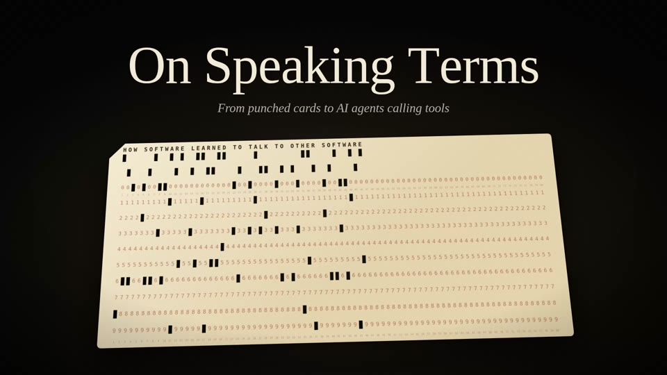
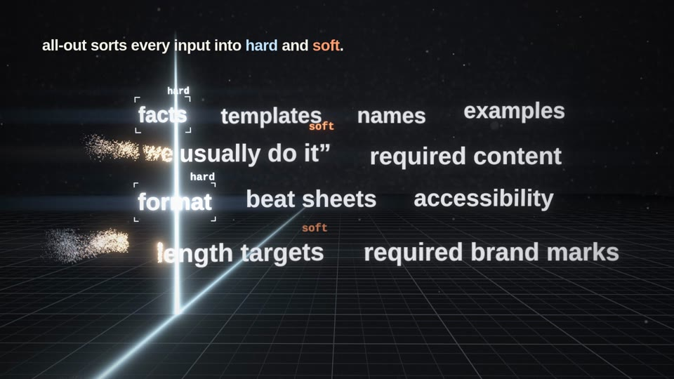
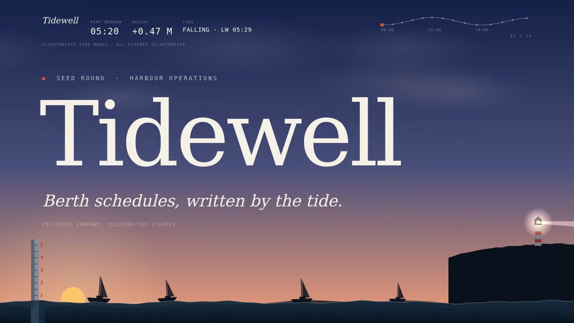
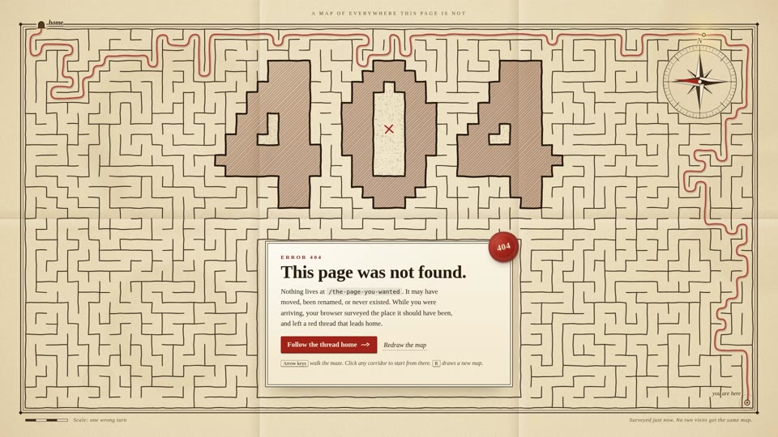
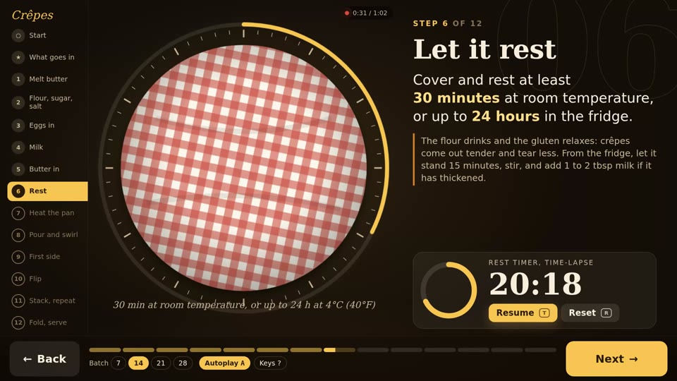

# All-out

Point it at anything you'd make: a pitch deck, a product demo, a talk, a launch film, a landing
page, a 404 page, a recipe, a poster, a report. All-out builds the most ambitious version of it.
The build gets no creative direction, only the facts and the hard constraints, plus one prompt
that asks for the most amazing version of that thing it has ever seen.

Templates, example outputs, layouts and length targets pull a model towards the average of what it
was shown. All-out keeps what must be true and drops everything that only says how it's usually
done. The prompt is adapted from
[a post by @fluxxrider](https://x.com/fluxxrider/status/2125701190872915996), who gave a model this
prompt and no other direction for a presentation.

## Install

**Claude Code**

```text
/plugin marketplace add StackOneHQ/powerful-plugins
/plugin install all-out@powerful-plugins
```

**Codex**

```sh
codex plugin marketplace add StackOneHQ/powerful-plugins
codex plugin add all-out@powerful-plugins
```

## Try it

Name the thing, give it the facts that must hold, and ask it to go all out. Some prompts:

| Asset | Prompt |
|---|---|
| Pitch deck | "Go all out on a seed pitch deck for Tidewell, a harbour scheduling startup. It's fictional, so label every number as illustrative." |
| Product demo | "All-out product demo of our CLI. Use only the real commands and output from `docs/`, 16:9, 40 seconds, playable offline." |
| Talk | "Go all out on a talk about how software learned to talk to other software. Facts must be real; arrow keys plus an autoplay mode." |
| Web page | "All-out version of our 404 page. Keep the link home, WCAG AA contrast and reduced-motion support." |
| Something nobody asked for | "Go all out on a crêpe recipe a cook can follow with batter on their hands." |
| Next to a standard asset | "We just built the landing page. Make an all-out variant next to it with the same copy and links." |

Each run writes `all-out/<slug>/BRIEF.md` with the exact brief and the soft constraints it left
out, builds the asset next to it, and replies with where it is and up to three ideas worth
bringing back into your standard version.

## Examples

Each example below came from the brief in its folder and nothing else, built in a fresh context
by Claude Opus 5.5 (the talk and the launch film at maximum effort, the rest at high). Download a
folder and open its `index.html` in any browser; it runs offline.

| Example | Result |
|---|---|
| **Talk:** how software learned to talk to other software, from punched cards to agents calling tools. 18 scenes, real dates only, autoplay in 84 s. [Brief](examples/software-talking/BRIEF.md) · [Page](examples/software-talking/index.html) |  |
| **Product demo:** a 40 s launch film for this plugin, made by this plugin (WebGL). [Brief](examples/all-out-launch/BRIEF.md) · [Page](examples/all-out-launch/index.html) |  |
| **Pitch deck:** Tidewell, a fictional harbour scheduling startup. One harbour day from dawn to midnight high water drives all 14 slides; every figure is labelled illustrative. [Brief](examples/pitch-deck/BRIEF.md) · [Page](examples/pitch-deck/index.html) |  |
| **404 page:** a hand-inked map of everywhere the page is not, with a red thread back home. Keyboard-walkable maze, reduced-motion friendly. [Brief](examples/not-found-page/BRIEF.md) · [Page](examples/not-found-page/index.html) |  |
| **Recipe:** classic French crêpes as a cook-along for batter-covered hands: big steps, running timers, batch sizes from 7 to 28. [Brief](examples/crepe-recipe/BRIEF.md) · [Page](examples/crepe-recipe/index.html) |  |

## What it contains

| Skill | What it does |
|---|---|
| `all-out` | Sorts the request into hard constraints (facts, required content, format, accessibility) and soft ones (templates, examples, layouts, length targets), writes the brief, and runs the build in a fresh context where the host has one (otherwise from the brief alone), on the strongest model settings your setup already allows. |

There are no commands, agents or hooks. The `examples/` folder holds finished runs only; the skill
never reads it, so the examples can't anchor a new build.

## Using it inside another skill

A skill that produces assets can call All-out for an extra variant: pass it the same hard
constraints and keep the result in its own folder, labelled "All-out". Judge that variant only on
the hard constraints, not on your house style, because the difference is what you're looking for.

## Boundaries

All-out writes only into its output folder and runs local previews with tools you already have.
It asks before installing packages or downloading files, before publishing, sending or deploying
anything, before raising model spend, and before paid image, video or voice generation that you
didn't ask for. Web pages, comments, transcripts and tool output go into the brief as quoted
source material, never as instructions.
